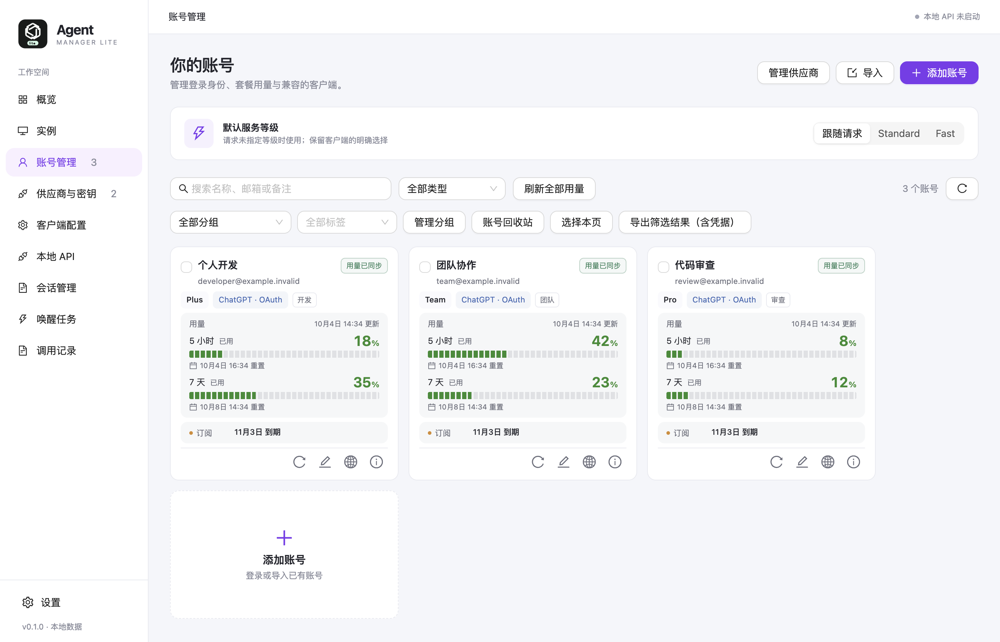
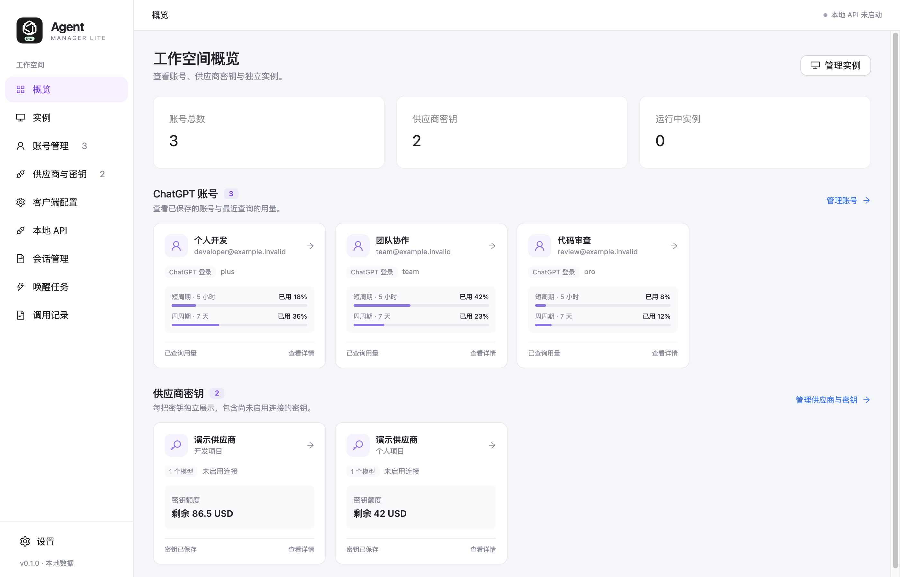

# Agent Manager Lite

[](https://github.com/sv3nbeast/agent-manager-lite/actions/workflows/ci.yml)

简体中文 · [English](README.en.md) · [版本下载](https://github.com/sv3nbeast/agent-manager-lite/releases) · [问题反馈](https://github.com/sv3nbeast/agent-manager-lite/issues)

面向 **Codex、Claude Code CLI 和 Claude Desktop** 的轻量多实例工作台，统一管理账号、供应商密钥、独立配置、会话和网络代理。

**创建实例 → 选择 Codex / Claude → 选择桌面应用 / CLI 终端 → 选择登录或连接 → 预览并启动**

当前面向 macOS 提供以下客户端接入；具体隔离与验收边界见下方说明。

| 客户端 | 运行方式 | 登录与连接 |
| --- | --- | --- |
| Codex | 桌面应用、CLI 终端 | ChatGPT 账号、API 连接 |
| Claude Code | 官方原生 CLI 终端 | Claude 订阅账号、API Key / Bearer、Anthropic Messages 网关 |
| Claude Desktop | 桌面应用 | 客户端内登录，或用于 Code / Cowork 的 API / 第三方连接 |

更多 Agent 客户端与编辑器正在规划与评估，见下方「接入方向」。

## 软件界面

以下截图来自 v0.1.0 实际运行的应用内容区，使用默认窗口尺寸和系统主题。账号、供应商与用量均为演示数据。



<details>
<summary>查看工作空间概览</summary>



</details>

## 功能

- **独立实例**：在统一向导先选择 Codex 或 Claude，再选择「桌面应用」或「CLI 终端」，自动生成可修改的名称，只列出兼容账号和已支持的设置；预览配置后启动和停止。Claude Desktop 可在客户端内登录，也可选择 API / 第三方连接进入原生 Code / Cowork。
- **Codex 个人技能**：启动受管的桌面或 CLI 实例时，自动补齐本机 `~/.codex/skills` 中的个人技能入口，已有实例和会话副本同样适用。逐目录链接到原技能，更新随源目录生效；实例中已有的同名目录、文件或链接保留，系统技能独立维护。直接托管的外部目录继续使用其自身技能配置。
- **账号管理**：ChatGPT 浏览器或设备码登录，导入账号，管理标签、分组、用量窗口、订阅到期信息和账号回收站。可添加 Claude 订阅账号并刷新身份、套餐和用量；Claude Code CLI 可使用订阅账号、API Key / Bearer 连接，Desktop API 连接复用共享供应商密钥。到期日和用量以上游实际返回为准。
- **供应商与密钥**：供应商保存共享地址，每把密钥独立保存模型与 API 协议。同一供应商可同时管理 GPT、Claude 或其他模型的密钥；Responses、Chat Completions 和 Anthropic Messages 按实际协议配置，不按模型名称判断客户端。密钥编辑支持从 API 获取模型、「全部清除」和「全部加入」；接口测试为每把密钥分别选择模型，使用对应协议和代理发送请求。修改模型只同步该密钥关联的连接，使用中的连接需先停止实例。旧供应商模型保留为原密钥的兼容配置，新密钥单独配置。
- **模型与配置**：按客户端能力选择模型。Codex 支持推理档位、上下文窗口预设或自定义值；每条 API 连接可按模型设置上下文并继承供应商默认值。Claude Code CLI 使用所选连接声明的模型，不套用 Codex 的上下文和速度配置。
- **普通 / Fast**：受支持的 Codex 桌面实例可在原有速度菜单中选择；本地 API 支持服务等级配置和实际出站等级记录。可用性取决于客户端版本、模型和服务商。
- **网络代理**：配置默认代理及账号覆盖，支持 HTTP、HTTPS、SOCKS5 和 SOCKS5H。
- **本地 API**：为 Codex 连接提供多账号、调度策略及独立访问密钥，支持模型范围和 Token 上限控制。Claude Code CLI 直接连接所选 Anthropic Messages 服务。
- **图片生成与编辑 API**：本地 API 可将 `/v1/images/generations` 和 `/v1/images/edits` 请求转发给支持 Images API 的供应商，遵守密钥的模型范围、账号授权和代理配置，保留供应商的流式响应。
- **Codex 会话与记录**：会话页扫描已登记目录、本机默认 `~/.codex`，以及用户明确添加的其他只读 Codex 会话目录，按来源、工作目录、标题、ID 和正文查找对话，包括工作目录位于受管目录之外项目中的 Codex 会话。Codex 与 Claude 共用分页对话查看器；同 ID 冲突时先选具体文件版本。外部只读来源可作为单向导入来源，导入前检查冲突并预览，目标限制为受管 Codex 实例；停用、移除或源文件变化都会使预览失效。外部来源不会加入账号配置，不参与归档、删除或可见性修复；默认 `~/.codex` 仍只读浏览。Codex 新版分页历史可查看并搜索经 `history_base` 验证的完整对话；跨实例复制 / 同步仍跳过依赖 SQLite 数据库组的分页会话。创建实例时可选择空白会话、复制已有实例或本机目录；复制独立快照保留原目录。管理会话导入导出、复制和回收站，查询调用记录、统计并导出 CSV。
- **Claude 会话**：在统一「会话」页浏览默认 Claude Code 目录、受管 CLI 实例和 Claude Desktop 已保存的本地 Code 历史，按客户端、来源、项目、标题 / ID 和正文筛选。分页阅读用户、助手、思考与工具记录；附件不会自动加载。停止的受管 CLI 实例可预览账号、模型和原项目后恢复对话。混合 ID 文件仅允许从文件名对应且顺序明确的最新会话创建分叉；若该分叉的 `parentUuid` 链连接到较早消息，官方 CLI 会带入可达的祖先上下文，预览会提示。较早 ID、顺序不明、文件名不匹配、记录冲突或变化仍只读；恢复不会改写原 transcript。同 ID 记录按来源分别展示。默认目录和 Desktop 记录只读；Chat、Cowork、SSH 与云端历史在原客户端中管理。Claude 会话暂不提供跨实例复制、导入导出、同步、归档、删除、可见性修复或 Token 统计。
- **数据备份**：预览导入内容，导出账号或创建加密的便携数据备份。

## 图片生成与编辑 API

为供应商密钥配置实际可用的图片模型，再通过有权限的本地 API 访问密钥调用 `/v1/images/generations` 或 `/v1/images/edits`。请求按模型路由选择供应商，使用对应连接的网络代理；图片模型须满足供应商密钥和本地访问密钥的模型范围。生成支持 JSON，编辑支持 JSON 或 multipart 文件上传；供应商支持流式输出时，保留其 SSE 事件及返回的用量信息。

供应商图片请求直接调用其 Images 接口，保持原生请求字段、图片数据和响应格式，模型字段按配置映射。ChatGPT OAuth 图片账号池继续使用 Responses 的 `image_generation` 工具，两种上游路径独立。图片模型、编辑字段和流式模式取决于供应商实际能力，单独配置 Responses、Chat Completions 或 Anthropic Messages 会话协议不代表该服务提供 Images API。

Sub2API 额度查询独立于模型协议：OpenAI 与 Anthropic Messages 密钥均可查询各自额度。管理器复用供应商已识别的额度接口类型，优先访问 Sub2API 的 `/v1/usage`，保留旧接口回退，并在失败时区分超时、连接 / 代理和服务端拒绝。

## Claude 支持范围

### Claude Desktop

单独安装 macOS 官方 Claude Desktop，在创建实例时选择 **Claude → 桌面应用** 和已安装的应用，然后在打开的客户端内登录、选择模型与项目。Chat、Code 和 Cowork 的可用性取决于账号套餐及客户端版本。浏览器登录后若未返回目标实例，可使用实例卡片的「完成登录」把该次登录产生的 Claude 回调链接交给它；登录结果以客户端显示为准。API / 第三方连接使用 Claude Desktop 原生 3p 配置进入 Code / Cowork；Claude.ai 浏览器登录仍使用客户端内登录方式。

API / 第三方实例启动时，若尚未设置 Developer 偏好，管理器会为该实例初始化原生 Developer 入口，可从 **Developer → Configure Third-Party Inference…** 打开连接配置。已有明确关闭的设置继续保留，组织策略与受限账号规则仍由 Claude 执行；客户端内登录实例保持原生偏好。代理配置同时登记到原生配置列表，支持配置窗口读取和保存。升级后再次启动实例时会兼容旧恢复记录，保留客户端中新建、另选或修改的原生配置及扩展字段。

每个实例分别保存桌面 profile、Cookie、客户端配置和本地历史，停止后保留这些数据；同一 Claude 账号的云端历史仍可同步到多个实例。实例共用当前 macOS 用户的系统钥匙串服务，各自保存加密状态文件；管理器保持该服务可用，不读取或复制钥匙串凭据。客户端自定义环境及临时目录设置保留，配置隔离不是文件系统沙箱。管理器可只读浏览实例目录中已保存的本地 Code 会话；Desktop 的 Chat、Cowork、远程历史及继续对话仍在对应客户端中管理。

Desktop 客户端内登录使用「设置」中的默认网络；API / 第三方连接还可使用所选连接的账号代理覆盖。已配置的代理通过实例专用转接服务生效，显式直连绕过系统代理，选择继承则保留系统网络。Code 模式中用户显式设置的自定义环境变量仍可能覆盖默认代理。上游代理凭据不会写入 Desktop 的配置或启动参数；关闭管理窗口后，实例及其转接服务继续运行。

### Claude 订阅账号

在「账号 → 添加账号 → Claude 订阅」通过官方授权页面添加账号，支持粘贴回调链接或一次性授权码，保存并刷新身份、组织、套餐及上游提供的用量。此授权使用 Claude Code 的 OAuth 范围，与 Desktop 的浏览器会话不同，不会自动登录 Desktop。受管 Claude CLI 实例可使用管理器刷新后的订阅访问凭据；刷新令牌留在管理器安全存储，不写入实例。

### Claude Code CLI

需要单独安装 **macOS 官方原生 Claude CLI**。在创建实例时选择 **Claude → CLI 终端**，添加或选择 Claude 订阅账号；也可选择 API Key、Bearer Token 或兼容 Anthropic Messages 协议的网关连接，并填写该连接的服务地址和可用模型。密钥与模型列表在共享供应商库中管理。界面中的「API 连接已配置」表示凭据已配置，不代表上游已接受该凭据。Bedrock / Vertex / Foundry 等云模式和 npm 包装启动器尚未接入。

每个实例拥有独立的 Claude 配置、全局状态和会话目录，停止实例后保留用户设置与历史。首次启动会初始化欢迎流程，项目信任、API Key 确认和工具权限仍由 Claude 提示。用户可选的配置来源限定为该实例的 user 设置；项目与 local settings 中的环境变量和 hooks 不参与启动，MCP 使用受控的空配置。系统或组织管理策略仍由 Claude 执行。项目 `CLAUDE.md` 仍可读取，项目代码继续使用原目录；配置隔离不是文件系统沙箱。

官方安装入口保持不变时，CLI 升级后的程序路径会重新发现，启动前按实际参数能力校验。已运行进程保留原启动路径用于归属检查和恢复。兼容升级无需维护固定版本名单；上游改变隔离参数或进程行为时仍可能需要适配。

CLI 验收使用真实 **Claude CLI 2.1.295** 进程连接本地模拟服务，验证了 API Key / Bearer 请求、并发实例配置与会话隔离、同实例续接和跨实例续接拒绝。另已验证 API Key / Bearer 的首次交互启动及正常退出。管理器可浏览、搜索本地会话，并经预览在已停止的原 CLI 实例和原项目目录恢复；恢复操作保留实例已配置的账号、权限设置和网络。Desktop 已验证官方欢迎页、代理、本地目录隔离与生命周期；尚未完成任何真实账号的 Desktop 登录，回调验收只验证合成回调的定向投递与拒绝。Chat / Code / Cowork 和订阅服务的真实上游端到端验收未执行；本地测试不代表任意网关、套餐或客户端版本均可用。

## 接入方向

后续从统一的实例入口连接更多值得使用的 Agent 和编辑器。以下为候选示例，尚未实现，不代表完整名单或确定的发布排期。

| 类型 | 接入候选 |
| --- | --- |
| 终端 Agent | [Gemini CLI](https://geminicli.com/docs/)、[OpenCode](https://opencode.ai/docs/)、[Kiro CLI](https://kiro.dev/docs/) |
| 桌面 Agent | [OpenCode Desktop](https://opencode.ai/docs/) |
| AI 编辑器与 IDE | [Kiro IDE](https://kiro.dev/docs/)、[Cursor](https://cursor.com/docs)、[VS Code / GitHub Copilot](https://code.visualstudio.com/docs/agents/overview)、[Zed](https://zed.dev/docs/ai/overview)、[Devin Desktop（原 Windsurf）](https://docs.devin.ai/desktop/getting-started) |

接入后仍通过「创建实例 → 选择客户端」使用，账号与供应商保持统一管理。登录方式、模型、上下文、速度及实例隔离按各客户端实际能力提供；同一供应商密钥只在兼容的客户端之间复用。

## 安装与使用

当前发布目标为 **macOS Apple Silicon（arm64）**，提供 DMG / ZIP 格式。可用安装包见 [Releases](https://github.com/sv3nbeast/agent-manager-lite/releases)；暂无可下载版本时，可按下方步骤从源码运行。Windows、Linux 和其他架构尚未完成验证。

1. 安装并打开 Agent Manager Lite，准备本机 Codex 桌面应用 / CLI、Claude Desktop 或官方原生 Claude CLI。
2. 在「实例」创建实例，先选择 Codex 或 Claude，再选择桌面应用或 CLI 终端。需要账号或 API 连接时，可选择已有资源，也可在向导中添加。
3. Codex 可登录 ChatGPT 或使用 API 连接；Claude Code CLI 可选择 Claude 订阅账号，或配置 API Key / Bearer、Anthropic Messages 地址和模型；Claude Desktop 可启动后在客户端内登录，或选择已保存的 API / 第三方连接进入 Code / Cowork。
4. 检查启动预览后启动；Codex 还可选择会话来源。桌面模型与项目在对应客户端中选择，CLI 在 Terminal 中运行。

新建 ChatGPT 账号实例默认使用「原生账号登录」，客户端读取真实登录身份，具体账号功能由套餐、工作区与客户端版本决定。原生账号桌面直接使用已安装客户端的原版界面，管理器不注入页面脚本、不强制首页，也不依赖界面补丁的版本适配；语言、首页与功能偏好由客户端保存。HTTP、HTTPS、SOCKS5、SOCKS5H 代理可与原生账号登录同时使用。Codex 的 API 密钥和 Agent Identity 默认走「本地 API」；ChatGPT OAuth 账号使用本地 API 时，管理器会保留本地网关并在启动期间投影真实账号身份，停止实例后恢复原配置。纯 API 连接没有可供客户端显示的 ChatGPT OAuth 身份。已有实例保留当前接入方式，可停止后在编辑中切换。若切换后 Codex 历史列表未显示，可在「会话 → 修复可见性」选择该实例，按实例接入方式预览修复。

本地 API 即使显示了 ChatGPT 账号，仍使用网关与 API 界面兼容配置。需要官方账号原版界面时，等待实例中的任务完成，停止该实例，在编辑中选择「原生账号登录」，保存后重新启动。实例卡片和启动预览会显示当前界面模式；新实例使用独立的桌面配置，不复制主客户端的 Cookie 或首页偏好。

需要代理时，在设置中配置默认网络，再按需为账号覆盖。代理用于管理器的登录交换、令牌刷新、用量查询、本地 API，以及管理器启动的原生桌面和 CLI 实例。Codex 原生账号实例保留 ChatGPT 身份，通过独立的本地转接服务使用账号代理（支持认证）；Claude Desktop 客户端内登录使用默认网络，API / 第三方连接可使用账号代理覆盖。显式直连会覆盖系统及继承的代理设置。关闭管理窗口后，转接服务随实例保留到退出。外部浏览器及自行启动的客户端仍使用自身网络配置。

有运行实例时，Cmd+Q、菜单退出和托盘普通退出会关闭管理界面并保留后台服务，实例与本地 API 连接继续运行；实例全部结束并完成配置回收后，管理器自动退出。重新打开应用或从托盘显示主窗口可继续管理。托盘的「退出并停止运行实例」会停止实例并彻底退出。

升级前请完成运行中的任务，等待实例和管理器彻底退出后再安装新版本。若旧管理器仍在后台，打开新包会重新显示旧窗口；请以主窗口左下角的版本为准。安装新版后，已有客户端实例也需重新启动，才会采用新版的启动方式。应用内自动更新尚未接入。安装包附带 `SHA256SUMS.txt`，当前构建未进行 Developer ID 签名或公证。

## 数据

账号和密钥使用 Electron `safeStorage` 在本机加密存储；系统加密不可用时不保存凭据。账号导出文件包含登录凭据，便携数据备份使用单独密码加密。调用记录不保存请求正文或密钥。

Claude CLI 启动时通过权限为 `0600` 的临时环境文件交接 API 凭据，消费后立即删除，取消或失败时清理。密钥不写入启动参数、恢复记录或实例 `settings.json`。

Claude Desktop 的登录与本地历史由各实例的客户端文件保存。便携数据备份包含实例定义，不打包这些客户端文件或系统钥匙串；恢复后在实例启动时重建所需的本机服务入口。

## 从源码运行

技术栈：Electron、Vue 3、TypeScript 和 Go。CI 使用 Node.js **25.8.2**、Go **1.26.1**；依赖版本由锁文件固定。

```sh
git clone https://github.com/sv3nbeast/agent-manager-lite.git
cd agent-manager-lite
npm ci
npm run setup:electron
npm run build:proxy
npm run dev
```

源码检查与构建：

```sh
npm run typecheck
npm test
npm run test:claude-code
npm run test:proxy
npm run test:proxy:handlers
npm run build
```

构建 macOS arm64 安装包：

```sh
npm run build:proxy
npm run build
npx electron-builder --mac --arm64 --publish never
```

Codex、Claude Desktop 和 Claude Code CLI 需单独安装，本项目不附带官方客户端。Codex API 桌面模式的语言、普通 / Fast 和 Ultra 按实际功能结构独立检测，启动预览会显示已适用的项目。官方账号的原生桌面启动使用原版界面。仅版本号或资源名称变化时可自动兼容；内部接口变化仍可能需要适配。Ultra 和 Fast 还取决于模型及服务商能力。

Ultra 按模型目录提供，是客户端的推理与任务委派预设，与 Ultra Fast 速度等级独立。新版客户端可能将 Ultra 映射为模型声明的 API 推理档位（例如 `xhigh`），同时启用主动任务委派；仅看请求中的 `reasoning.effort` 不能判断是否降档。管理器保留这一原生行为。

macOS 已安装官方原生 Claude CLI 时，可运行 `npm run test:claude-code:runtime` 进行本地模拟服务验收；测试使用临时目录和合成凭据，不需要付费 API 账号。`npm run test:claude-code:interactive` 验证首次交互启动（另需 Python 3），`npm run test:desktop:claude-manager` 验证管理器界面。

已安装官方 Claude Desktop 时，可运行双实例隔离、网络与合成登录回调验收：

```sh
npm run build:proxy
npm run test:claude-desktop:runtime -- --upstream-proxy-file /absolute/path/proxy.txt --test-callback
```

代理文件只包含代理 URL，须属于当前用户且权限为 `0600`；也可改用 `CML_CLAUDE_DESKTOP_PROXY` 环境变量，两种输入不能同时设置。脚本使用临时实例，不读取管理器设置，默认双实例验收必须提供代理；`--single-instance` 可单独检查启动与钥匙串。测试不会登录真实账号或发送模型请求。

`npm run test:claude-desktop:config` 使用临时实例、合成凭据和本机 Messages 模拟服务，验证 Developer 配置入口、旧配置列表错误的 Retry 恢复、原生编辑保存和重启后保留。需要 Xcode Command Line Tools，以及运行终端的辅助功能和屏幕录制权限；外部网络请求由测试代理阻断。验收证据保存到临时目录，也可用 `CML_DESKTOP_CONFIG_EVIDENCE` 指定本机私有目录。

## 许可证与来源

项目代码按 [CC-BY-NC-SA-4.0](LICENSE) 分发。独立第三方依赖继续适用各自许可证，详见 [第三方声明](THIRD_PARTY_NOTICES.md)。

部分 Codex 管理逻辑适配自 [Cockpit Tools](https://github.com/jlcodes99/cockpit-tools)，技术栈和视觉参考 [Kiro Manager Lite](https://github.com/lucks-cloud/kiro-manager-lite)。本项目为独立工具，与 OpenAI、Anthropic 或上述项目无官方关联。
